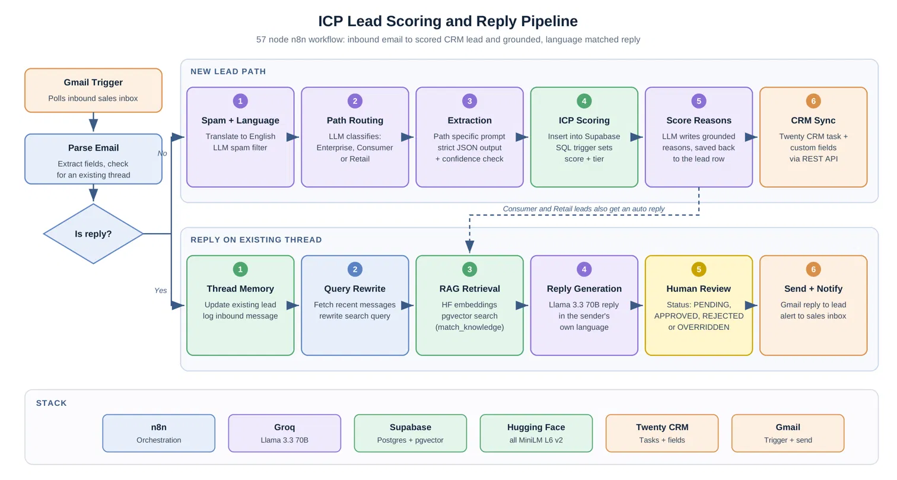

# ICP Lead Scoring and Reply Pipeline



A production style n8n pipeline that turns inbound sales emails into scored,
qualified CRM leads with grounded, language matched replies. Adapted from a
system I built during my AI architecture internship at an AI consultancy, with
all client data replaced by a fictional brand ("Lumen Living") and sample data.

It classifies each email by business path (enterprise, consumer or retail),
extracts structured fields with an LLM, scores the lead against an Ideal
Customer Profile in SQL, syncs it to a CRM, and drafts a reply in the sender's
own language with a human review gate before anything is sent.

## What it does

1. **Trigger:** a Gmail trigger polls the sales inbox for new email.
2. **Spam and language:** an LLM spam check filters junk, and non English
   email is translated to English for processing.
3. **Path routing:** an LLM classifies the email as Enterprise ("K"),
   Consumer or Retail and routes it to the matching branch.
4. **Extraction:** a path specific prompt extracts structured signals
   (intent, budget, timeline, sponsor, location and more) as strict JSON,
   with a confidence check on the enterprise path.
5. **ICP scoring:** the lead is inserted into Supabase, where a SQL trigger
   scores six weighted attributes, applies penalties, and sets the score,
   tier, confidence and review flags.
6. **Score reasons:** an LLM writes short, grounded reasons for the score,
   saved back to the lead.
7. **CRM sync:** a task with custom fields is created in Twenty CRM over
   its REST API.
8. **Replies:** for replies on an existing thread, the pipeline loads recent
   messages, rewrites the search query, retrieves context with RAG
   (pgvector), and generates a reply in the sender's language.
9. **Human review:** every reply carries a review status (`PENDING`,
   `APPROVED`, `REJECTED`, `OVERRIDDEN`), so nothing high stakes is sent
   unchecked. The sales inbox gets a notification for consumer and retail
   leads.

## Design decisions

- **Deterministic scoring.** The LLM only extracts signals. Scoring happens
  in SQL, so every score is auditable, reproducible and independent of
  model drift.
- **Three scoring models.** Enterprise, consumer and retail leads are scored
  on different attributes, because a furniture retailer and a consulting
  client are qualified in completely different ways.
- **Review flags over auto decisions.** Ambiguous signals (no sponsor,
  unverified business, missing address) raise flags that force human review.
  Retail leads are never auto approved or auto rejected.
- **Conversation memory.** Every inbound and outbound message is logged per
  thread, and replies update the existing lead instead of creating duplicates.
- **Language matching.** Email is processed in English and answered in the
  sender's original language.

## Stack

| Layer | Tool |
|---|---|
| Orchestration | n8n (57 nodes) |
| LLM | Groq, Llama 3.3 70B |
| Embeddings | Hugging Face, `all-MiniLM-L6-v2` |
| Database and vectors | Supabase (Postgres + pgvector) |
| CRM | Twenty CRM (REST API) |
| Email | Gmail (trigger and send) |

## Repo structure

```
icp-lead-pipeline.json   n8n workflow (import into n8n)
sql/schema.sql           tables, scoring triggers, RAG and memory functions
architecture.webp        architecture diagram
.env.example             environment variables to fill in
```

## Setup

1. Import `icp-lead-pipeline.json` into n8n (Workflows → Import from File).
2. Copy `.env.example` to `.env` and fill in your own keys. **Never commit `.env`.**
   ```bash
   cp .env.example .env
   ```
3. In n8n, add the credentials the workflow references (every credential ID
   in the JSON is a placeholder):
   - **Supabase** credential for the Supabase nodes.
   - **Gmail OAuth2** credentials for the triggers and send nodes.
   - Expose `GROQ_API_KEY`, `HF_API_KEY`, `SUPABASE_KEY` and `TWENTY_API_KEY`
     to n8n as environment variables. The HTTP and code nodes read them via
     `{{ $env.GROQ_API_KEY }}` and `process.env.SUPABASE_KEY`.
4. Run `sql/schema.sql` in the Supabase SQL Editor. It creates the tables,
   the three ICP scoring triggers, and the RAG and memory functions.
5. Point `TWENTY_HOST`, `SUPABASE_URL` and `N8N_HOST` at your own instances.

## Notes

- All brand names, clients, catalogue items and data in this repo are
  fictional. Every key, token, URL and credential ID is a placeholder.
